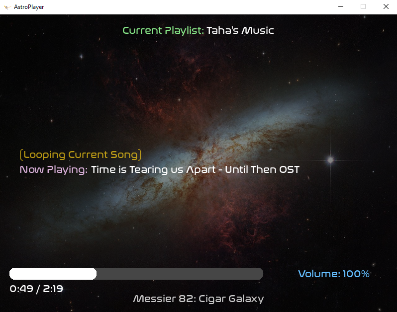
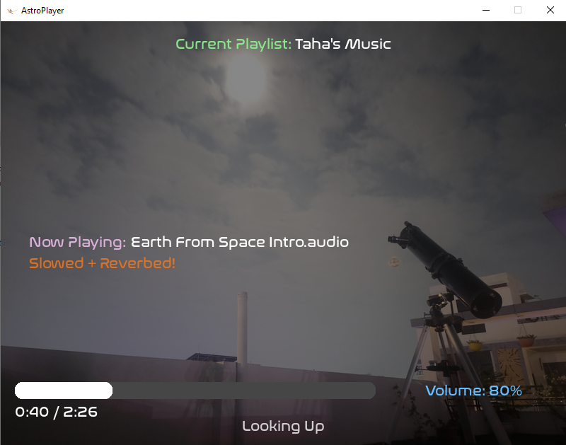
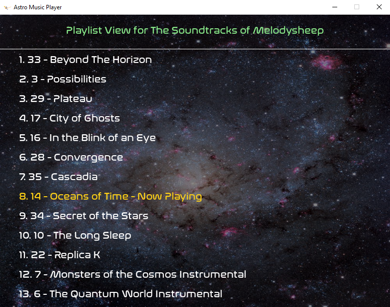

# AstroPlayer
**A lightweight Astronomy-Themed local Music Player built with Python on a weekend just for fun!**

_**Backstory:**_ I was originally trying to make a simple python script using pygame to randomly play some of my downloaded Melodysheep music while i study. Then one thing led to another, I kept adding some features i liked, Took some help from ChatGPT and thus AstroPlayer was born!

## Screenshots

## Features
- Multiple playlists Support
- Random Messier/Space backgrounds
- Progress bar for the current Song
- Seekable playback (Via clicking the Progress Bar)
- Global volume controls (Works even when AstroPlayer is not Focused)
- Pause/Resume
- Previous/Next track
- Automatic playlist shuffling
- A Playlist View with Selectable Songs (Click Song names to play)
- Inbuilt Audio Processing for 2 Effects: Slowed + Reverb and Nightcore!
- Adjustable Audio Effects Parameters

## Controls
| Key | Action |
|------|--------|
| ← / → | Previous / Next Track |
| Space | Pause / Resume |
| + / - | Global Volume Control |
| , / . | Switch Playlists |
| P | Toggle Playlist View |
| L | Toggle Current Song Looping |
| N | Toggle Nightcore Mode |
| S | Toggle Slowed + Reverb Mode |
| ↑ / ↓ | Scroll Playlist View |
| Esc | Exit |

## Customization
- To add your own Background images, Replace or Add New `.jpg` files in the Assets/Images folder. The Program will include them automatically.
- To add your Music, You can place new `.mp3` or `.wav` or `.ogg` in a Playlist folder under the Assets/Playlists folder or remove the ones you don't like from the same. The Program will Auto-Update on the next Start.
- You can further organise your songs by creating as many playlists as you like, You can do so by creating a folder inside Assets/Playlists and it will count as a New Playlist (For ex. Study, Cozy, Space etc) in the Program after a restart.

## Requirements
- Windows
- Python 3.12+ and the Program's Dependencies (to run the python source code)
- Or download the pre-built executable from the Releases page.

## Current Feature list to be Implemeneted into the Player
1. [x] A Selectable Playlist View 
2. [x] A Looping Feature for the Current Playing Song 
3. [x] A Nightcore/Slowed Mode that changes the Audio Playback
4. [ ] A "Disco Mode" that makes the Background images react with the Music

## License
This project is licensed under the MIT License.

(I originally also bundled some music as per my choices with AstroPlayer, but had to remove it (Cause Copyright laws, Ofcourse). It was really disappointing tbh)

## Notes 
- AstroPlayer requires at least one supported audio file (`.mp3`, `.wav`, or `.ogg`) in one of the playlist folders to start playback.

- When toggling one of the Audio Effects (Nightcore/Slowed + Reverb), AstroPlayer might freeze for a few moments. This is expected behaviour as the Program is Processing the files in the Background. (This Freeze will only happen when you first Toggle the Effects for that Particular Audio File per Launch. The Subsequent times, AstroPlayer will use the Cached files)

- If you want to Adjust the Parameters (Strength) of the Audio Effects, You can do so by editing the Numeric Values in the `AudioEffects_Config.txt` (Please do not change the Structure of the Config file while changing the Parameters as that could result in unforseen errors (That i was too tired to Iron out or write Edge cases for)).

- You can Download the latest pre-built executable from the **Releases** page, or run the source code using Python.

_**Thanks a lot for your time! Cya later :D**_